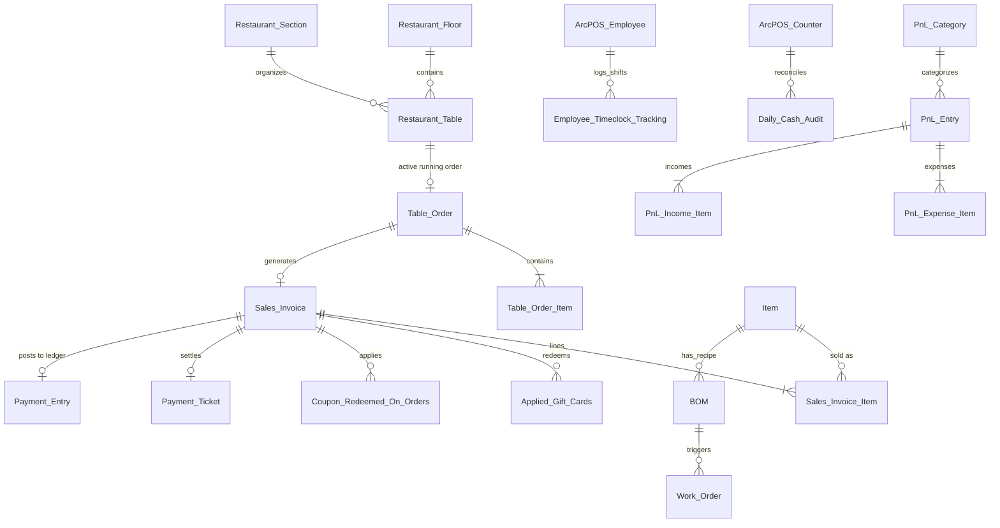

# Excel Restaurant POS (ArcPOS) — Complete Technical Documentation

> **Version:** 1.8.0+  
> **Platform:** Frappe Framework v15 / ERPNext  
> **Frontend:** React 18 PWA (Vite + TypeScript + Tailwind CSS / DaisyUI + Redux Toolkit)  
> **Real-Time Engine:** Standalone Node.js Socket.IO Server (Port 9001) + Redis Pub/Sub  
> **Author & Maintainer:** Sohanur Rahman & Excel Technologies Ltd  
> **License:** MIT  

---

## Table of Contents

1. [Executive Summary & System Architecture](#1-executive-summary--system-architecture)
2. [Technology Stack & Directory Structure](#2-technology-stack--directory-structure)
3. [Authentication, Security & Access Control](#3-authentication-security--access-control)
   - [Custom JWT Authentication](#custom-jwt-authentication)
   - [OAuth & Social Logins (Google & Apple)](#oauth--social-logins-google--apple)
   - [Cloudflare Turnstile, Honeypots & Rate Limiting](#cloudflare-turnstile-honeypots--rate-limiting)
   - [Role-Based Access Control (RBAC)](#role-based-access-control-rbac)
   - [Customer PII Masking & Shared Table Access](#customer-pii-masking--shared-table-access)
4. [Database Architecture, ERD & Technical Data Models](#4-database-architecture-erd--technical-data-models)
   - [Entity Relationship Diagram (ERD)](#entity-relationship-diagram-erd)
   - [The 66 DocTypes Categorized Catalog](#the-66-doctypes-categorized-catalog)
   - [Physical MariaDB Tables & Core Schema Definitions](#physical-mariadb-tables--core-schema-definitions)
   - [MariaDB Stored Procedures & Dynamic Migration Sync](#mariadb-stored-procedures--dynamic-migration-sync)
   - [Indexing Strategy, Uniqueness & Query Optimizations](#indexing-strategy-uniqueness--query-optimizations)
   - [Historical Schema Migration Patches (v1.1.0 to v1.11.0)](#historical-schema-migration-patches-v110-to-v1110)
   - [Redis In-Memory Topology & Messaging Architecture](#redis-in-memory-topology--messaging-architecture)
   - [WebSocket Protocol & Socket.IO Frame Structure](#websocket-protocol--socketio-frame-structure)
5. [Order Lifecycle & Sales Invoicing Engine](#5-order-lifecycle--sales-invoicing-engine)
   - [Service Types: Dine-In, Takeaway, Delivery](#service-types-dine-in-takeaway-delivery)
   - [Table Orders & Multi-Diner Collaboration](#table-orders--multi-diner-collaboration)
   - [Sales Invoice Document Events & Handlers](#sales-invoice-document-events--handlers)
   - [Idempotent Checkout & Replay Protection](#idempotent-checkout--replay-protection)
6. [Discounts, Promotional Coupons & Gift Cards](#6-discounts-promotional-coupons--gift-cards)
   - [Promotional Coupons Lifecycle](#promotional-coupons-lifecycle)
   - [Gift Cards: Issuance, Bulk Stock & Multi-Card Redemption](#gift-cards-issuance-bulk-stock--multi-card-redemption)
7. [Third-Party Integrations](#7-third-party-integrations)
   - [Clover POS Integration](#clover-pos-integration)
   - [Uber Eats (Catalog Sync, Orders, Webhooks & Status)](#uber-eats)
   - [DoorDash Integration](#doordash-integration)
   - [Uber Direct Delivery Dispatch](#uber-direct-delivery-dispatch)
8. [Employee Timeclock & Shift Tracking](#8-employee-timeclock--shift-tracking)
   - [Encrypted 6-Digit PIN Authentication](#encrypted-6-digit-pin-authentication)
   - [Business Day Cutoff Rules](#business-day-cutoff-rules)
   - [Wage Snapshotting & Manager Overrides](#wage-snapshotting--manager-overrides)
   - [High-Performance MariaDB Stored Procedure](#high-performance-mariadb-stored-procedure)
9. [Kitchen Display System (KDS), BOM & Production](#9-kitchen-display-system-kds-bom--production)
10. [Floor Plan, Tables & Reservation System](#10-floor-plan-tables--reservation-system)
11. [Accounting, Cash Audit & PnL Management](#11-accounting-cash-audit--pnl-management)
12. [Real-Time WebSocket Server & Push Notifications](#12-real-time-websocket-server--push-notifications)
13. [Scheduled Tasks, Cron Jobs & Background Workers](#13-scheduled-tasks-cron-jobs--background-workers)
14. [Public & Internal REST API Reference](#14-public--internal-rest-api-reference)
15. [Frontend Portal Application (`portal/`)](#15-frontend-portal-application-portal)
16. [Installation, Configuration & Deployment Guide](#16-installation-configuration--deployment-guide)

---

## 1. Executive Summary & System Architecture

**Excel Restaurant POS (ArcPOS)** is an enterprise-grade, omnichannel Point-of-Sale, Kitchen Display System (KDS), Table Management, and Online Ordering platform built on top of the **Frappe Framework** and tightly integrated with **ERPNext**.

The system addresses the end-to-end operational demands of modern food & beverage enterprises:
- **Omnichannel Ordering:** In-person POS, collaborative table QR ordering, web storefront ordering, phone takeaway, and delivery integrations (Uber Eats, DoorDash, Uber Direct).
- **Kitchen & Back-of-House:** Multi-station KDS, automated Bill of Materials (BOM) stock consumption, ERPNext Work Order / Stock Entry generation, and wastage tracking.
- **Financial Integrity:** Ledger-posted Sales Invoices, automated Payment Entries, promotional discount journals, multi-payment ticket settlements, split billing, and daily cash drawer audits.
- **Workforce Management:** Timeclock with encrypted PIN authentication, shift tracking, overtime/cost calculation, and MariaDB stored procedure analytical reports.
- **Real-Time Responsiveness:** Dual-stack event dispatch using a dedicated Node.js Socket.IO server on port 9001 alongside Redis Pub/Sub.

```
                              ┌──────────────────────────────────────────────┐
                              │            Clients / Frontends               │
                              ├──────────────────────┬───────────────────────┤
                              │   React Portal PWA   │  Public Storefront    │
                              │   (/restaurant)      │  (Mobile Web / Apps)  │
                              └──────────┬───────────┴───────────┬───────────┘
                                         │                       │
                               HTTP / REST (JWT)           HTTP / REST
                                         │                       │
                                         ▼                       ▼
┌─────────────────────────┐   ┌──────────────────────────────────────────────┐
│  Node.js Socket.IO      │   │          Frappe / ERPNext Web Server         │
│  Server (Port 9001)     │◄──┤  • hooks.py auth hook (JWT validation)       │
│  • Bearer Token Auth    │   │  • Rate Limiting & Cloudflare Turnstile      │
│  • Room & Namespace Hub │   │  • Whitelisted API Routers (/api/method/...) │
└────────────▲────────────┘   └──────────────────────┬───────────────────────┘
             │                                       │
             │ Redis Pub/Sub                         │ Python ORM & SQL DDL
             │ ("events",                            ▼
             │  "excel_restaurant_pos_events") ┌──────────────────────────────┐
             └─────────────────────────────────┤  MariaDB Database            │
                                               │  • 66 Custom DocTypes        │
                                               │  • Stored SQL Procedures     │
                                               │  • ERPNext Standard Ledgers  │
                                               └──────────────────────────────┘
```

---

## 2. Technology Stack & Directory Structure

### Technology Stack
- **Backend Core:** Frappe Framework v15, ERPNext, Python 3.10+, MariaDB 10.6+
- **Caching & Message Broker:** Redis (Cache & Queue & Pub/Sub)
- **Real-Time Communication:** Node.js, `socket.io` 4.x, `ioredis`
- **Frontend Stack:** React 18, TypeScript 5.6, Vite 5.4, Tailwind CSS 3.4, DaisyUI 4.12, Redux Toolkit 2.2, `frappe-react-sdk`, React Router v6
- **Push Notification Engine:** Expo Push Notifications SDK
- **Integrations:** Clover REST API & Webhooks, Uber Eats API, DoorDash Drive API, Uber Direct Delivery API, Cloudflare Turnstile

### Repository Directory Structure
```
excel_restaurant_pos/
├── docs/                               # Feature guides and PRDs
│   ├── coupon-order-status.md          # Coupon lifecycle spec
│   ├── employee-timeclock-api.md       # Timeclock API documentation
│   ├── gift-card-frontend-guide.md     # Gift card frontend integration guide
│   ├── item-search-api.md              # Typo-tolerant item search guide
│   ├── order-antispam.md               # Turnstile & honeypot anti-spam spec
│   ├── order-receipt-pdf-api.md        # Receipt PDF endpoint documentation
│   └── report-sql-procedures.md        # MariaDB stored procedure architecture
├── excel_restaurant_pos/               # Main Python package
│   ├── api/                            # 35 Whitelisted API modules
│   │   ├── auth/                       # JWT, Google, Apple, password reset
│   │   ├── bom/                        # BOM execution & work order creation
│   │   ├── clover/                     # Clover POS sync & webhooks
│   │   ├── coupon/                     # Coupon generation & validation
│   │   ├── gift_card/                  # Gift card stock, sale, redemption
│   │   ├── item/                       # Item CRUD & fuzzy ranked search
│   │   ├── payments/                   # Payment tickets, split settlement
│   │   ├── report/                     # Analytical reports
│   │   ├── sales_invoice/              # Order placement & modification
│   │   ├── timeclock/                  # PIN check-in/out & manager override
│   │   └── uber_eats/                  # Uber Eats 2-way catalog & orders
│   ├── doc_event/                      # Frappe document lifecycle hooks
│   │   ├── item/                       # Item search index cache clearers
│   │   ├── payment_entry/              # Settlement & order status triggers
│   │   └── sales_invoice/              # Order status, discount journals, stock
│   ├── doctype/                        # 66 Custom DocTypes
│   ├── overrides/                      # Class & method overrides (User, Item)
│   ├── realtime/                       # Standalone Socket.IO server (Port 9001)
│   ├── report_sql/                     # MariaDB Stored Procedures (.sql)
│   ├── shared/                         # Domain logic (antispam, coupons, access)
│   ├── utils/                          # JWT auth, rate limiter, cron scheduler
│   ├── www/                            # Web routes (restaurant.html host)
│   ├── auth.py                         # Global JWT request validator hook
│   └── hooks.py                        # Frappe App Manifest & event registration
├── portal/                             # React + Vite frontend source code
│   ├── src/
│   │   ├── components/                 # Modals, layout items, badges
│   │   ├── pages/                      # POS, KDS, Tables, Dashboard, Stock
│   │   ├── redux/                      # Cart, auth, session state
│   │   └── routes/                     # React Router configurations
│   ├── package.json
│   └── vite.config.ts
└── README.md
```

---

## 3. Authentication, Security & Access Control

### Custom JWT Authentication
The application incorporates a high-performance **Bearer Token** authentication mechanism via `excel_restaurant_pos.auth.validate`:
1. Requests bearing `Authorization: Bearer <token>` bypass session cookies.
2. The token is parsed using `excel_restaurant_pos.utils.jwt_auth.verify_token(token, token_type="access")`.
3. The authenticated user is set directly on `frappe.local.session.user` and `frappe.local.session.sid` without calling `frappe.set_user()`, preserving query parameters and `form_dict` state intact.
4. Tokens are checked against a token blacklist cache (for invalidated sessions and logouts). Expired blacklist entries are purged daily via cron.

### OAuth & Social Logins (Google & Apple)
- **Google Sign-In (`api/auth/google.py`):** Accepts Google ID tokens, validates them against Google's token verification endpoints, creates or links a Frappe `Customer` and `User`, and mints an ArcPOS JWT pair.
- **Apple Sign-In (`api/auth/apple.py`):** Validates Apple identity tokens, decrypts Apple user claims, handles private relay email addresses, and provisions accounts.

### Cloudflare Turnstile, Honeypots & Rate Limiting
Public storefront ordering endpoints (`api.sales_invoices.add`, `overrides.user.sign_up`, `api.auth.login.login`) are defended against automated scraping, credential stuffing, and bot orders:
1. **Idempotency Check:** Replayed network requests return the existing invoice immediately without re-verifying spent tokens.
2. **Honeypot Trap:** Hidden decoy fields (`website_url`, `phone_confirm`) trap automated scripts. Submissions with filled honeypots are rejected locally without database overhead.
3. **Submission Velocity Gate:** Sign-up submissions arriving faster than 3 seconds from `form_started_at` are flagged and rejected.
4. **Cloudflare Turnstile Validation (`shared/antispam/turnstile.py`):**
   - Single-use, short-lived tokens verified against Cloudflare's `siteverify` API.
   - Action binding (`data-action="checkout"`, `"signup"`, `"login"`): A token solved for login cannot be replayed for checkout.
   - Hostname binding (`arcpos_turnstile_hostnames`): Enforces that tokens were issued exclusively by registered storefront origins.
5. **Token Bucket Guest Rate Limiting (`utils/rate_limit.py`):**
   - Executed inside the `before_request` hook for all guest requests.
   - Per-IP rate limiting: 120 req/min for catalog reads (e.g. `api.items.list`), 30 req/min for writes, with an overall global flood cap of 200 req/min per IP. Authenticated JWT callers are exempt.

### Role-Based Access Control (RBAC)
The app registers 22 specialized roles in `hooks.py`:
- **Storefront & Customer:** `Web Customer` (minimal read-only permissions, PII isolated).
- **Service & Floor Staff:** `Restaurant Waiter`, `Restaurant Cashier`, `Bartender`, `Delivery Staff`.
- **Kitchen & Back of House:** `Restaurant Chef`, `Restro Kitchen Staff`.
- **Management & Administration:** `Restaurant Manager`, `ArcPOS Manager`, `ArcPOS Deny`.
- **Inventory & Supply Chain:** `ArcPOS Stock User`, `ArcPOS Transfer Creator`, `ArcPOS Transfer Approver`, `ArcPOS PCM Creator`, `ArcPOS PCM Approver`, `ArcPOS Recipe User`, `ArcPOS Recipe Approver`.
- **Channel & Marketing:** `ArcPOS Register User`, `ArcPOS Pickup User`, `ArcPOS Delivery User`, `ArcPOS Channel User`, `ArcPOS Reservation User`, `ArcPOS Coupon Manager`.

### Customer PII Masking & Shared Table Access
`excel_restaurant_pos.shared.customer_access` enforces granular ownership rules:
- An individual customer can only access, view, or settle their own Sales Invoices.
- **Collaborative Table Ordering Exception:** A table's active running order (`Restaurant Table.running_order`) allows multiple diners seated at the same physical table to view the bill and order food. However, any diner who is not the original order owner receives the document with all Personally Identifiable Information (PII) stripped (full name, phone number, email, address, delivery coordinates). Only the owner can execute payments, cancel orders, or download receipts.

---

## 4. Database Architecture, ERD & Technical Data Models

### 4.1 Entity Relationship Diagram (ERD)

The database links core restaurant floor entities, food items, ERPNext sales ledgers, workforce attendance, and payment settlements:



---

### 4.2 The 66 DocTypes Categorized Catalog

| Functional Domain | Physical MariaDB Tables | Functional Description |
|---|---|---|
| **Tables & Floor** | `tabRestaurant Floor`<br>`tabRestaurant Section`<br>`tabRestaurant Table`<br>`tabTable Order`<br>`tabTable Order Item`<br>`tabTable Reservation` | Floor plans, geometric table coordinates `(x, y)` for the visual editor, live occupancy states, running collaborative table orders, and booking calendars. |
| **Menu & Catalog** | `tabFood Category`<br>`tabFood Item List`<br>`tabMenus`<br>`tabItem Menus`<br>`tabMenu Availability`<br>`tabVisibility Time Slot`<br>`tabAdd Ons Items`<br>`tabAdd Ons Item`<br>`tabNotes Variants`<br>`tabGuest Choice`<br>`tabHow To Prepare Table`<br>`tabDietary`<br>`tabDietary Table`<br>`tabFood Allergens`<br>`tabAllergens Table`<br>`tabNutritions`<br>`tabWebsite Frequent Items` | Omnichannel food catalog, time-delimited menu schedules, modifier add-on groups, preparation instructions, dietary tags, and allergen matrix. |
| **Billing & Payments** | `tabPayment Ticket`<br>`tabPayment Mode`<br>`tabDaily Cash Audit`<br>`tabArcPOS Counter`<br>`tabOutlet Wise Counters`<br>`tabDynamic Delivery Charge`<br>`tabTips Criteria` | Multi-tender split bills, tip distributions, cash drawer float tracking, and territory delivery charges. |
| **Discounts & Loyalty** | `tabRestaurant Coupon`<br>`tabCoupon Redeemed On Orders`<br>`tabApplied Gift Cards`<br>`tabDiscount Allocation`<br>`tabArcPOS Offers` | Flat/percentage coupons, multi-card gift redemptions, automatic coupon invalidation on cancelled orders, and marketing offers. |
| **Integrations** | `tabClover Integration`<br>`tabClover Payment`<br>`tabChannel Order`<br>`tabChannel Order Item` | Clover merchant sync, Uber Eats and DoorDash order ingests. |
| **Staff & Timeclock** | `tabArcPOS Employee`<br>`tabEmployee Timeclock Tracking` | Staff directory, site-encrypted 6-digit PIN authentication, wage tracking, and manager shift overrides. |
| **Kitchen & BOM** | `tabRestaurant Production Config`<br>`tabBOM Process Log` | Automatic ERPNext Work Order and Stock Entry creation from food BOM recipes. |
| **Accounting & PnL** | `tabPnL Entry`<br>`tabPnL Category`<br>`tabPnL Income Item`<br>`tabPnL Expense Item`<br>`tabPnL Attachments` | Operational store profit and loss tracking, expense categorization, and receipt scans. |
| **Feedback & Reviews** | `tabArcPOS Feedback`<br>`tabFeedback Items`<br>`tabSocial Review Feedback` | Customer satisfaction metrics, dish ratings, and social review tracking. |
| **Push Notifications** | `tabArcPOS Push Notification`<br>`tabArcPOS Notification Token`<br>`tabPush Token List` | Expo mobile device push tokens and dispatch history. |
| **Settings & Customers** | `tabArcPOS Settings`<br>`tabRestaurant Settings`<br>`tabArcPOS System Settings`<br>`tabArcPOS Client Contact`<br>`tabArcPOS Customer Address`<br>`tabArcPOS Delivery`<br>`tabAttachment` | Global POS configuration singletons, tax templates, address normalizers, and CRM contacts. |

---

### 4.3 Physical MariaDB Tables & Core Schema Definitions

All documents are stored in MariaDB under the standard Frappe table prefix `tab<DocType Name>`. Standard ERPNext tables are extended with specialized ArcPOS custom fields.

#### 1. `tabSales Invoice` (Extended Core Transaction Table)
Stores both POS and Online orders. Key custom fields injected:
```sql
ALTER TABLE `tabSales Invoice`
    ADD COLUMN `custom_order_type` VARCHAR(50) DEFAULT 'Dine In',       -- 'Dine In', 'Takeaway', 'Delivery'
    ADD COLUMN `custom_order_from` VARCHAR(50) DEFAULT 'POS',           -- 'POS', 'Website', 'Table QR', 'Uber Eats'
    ADD COLUMN `custom_order_status` VARCHAR(50) DEFAULT 'New',         -- 'New', 'Preparing', 'Ready to Serve', 'Completed', 'Cancelled'
    ADD COLUMN `custom_service_type` VARCHAR(50) DEFAULT 'Dine In',
    ADD COLUMN `custom_linked_table` VARCHAR(140),                      -- FK -> tabRestaurant Table.name
    ADD COLUMN `custom_party_size` INT DEFAULT 1,
    ADD COLUMN `custom_customer_full_name` VARCHAR(140),
    ADD COLUMN `custom_mobile_no` VARCHAR(50),
    ADD COLUMN `custom_email_address` VARCHAR(140),
    ADD COLUMN `custom_delivery_date` DATE,
    ADD COLUMN `custom_delivery_time` TIME,
    ADD COLUMN `custom_delivery_location` TEXT,
    ADD COLUMN `custom_address_instruction` TEXT,
    ADD COLUMN `custom_pickup_ready` DATETIME,
    ADD COLUMN `custom_pickup_deadline` DATETIME,
    ADD COLUMN `custom_dropoff_ready` DATETIME,
    ADD COLUMN `custom_dropoff_deadline` DATETIME,
    ADD COLUMN `custom_coupon_code` VARCHAR(140),                       -- FK -> tabCoupon Code.name
    ADD COLUMN `custom_gift_cards_for` TEXT,
    ADD COLUMN `custom_generated_gift_cards` TEXT,
    ADD COLUMN `custom_cutlery` INT(1) DEFAULT 0,
    ADD COLUMN `custom_is_deleted` INT(1) DEFAULT 0;                     -- Soft delete marker for nightly purge
```

#### 2. `tabSales Invoice Item` (Extended Line Item Table)
```sql
ALTER TABLE `tabSales Invoice Item`
    ADD COLUMN `custom_item_status` VARCHAR(50) DEFAULT 'Pending',      -- 'Pending', 'Preparing', 'Ready', 'Served', 'Cancelled'
    ADD COLUMN `custom_is_parcel` INT(1) DEFAULT 0,                     -- Takeout pack packaging flag
    ADD COLUMN `custom_notes` TEXT,                                     -- Customer preparation requests
    ADD COLUMN `custom_item_section` VARCHAR(140),                      -- Routing station ('Kitchen', 'Grill', 'Bar')
    ADD COLUMN `custom_addons` LONGTEXT;                                -- Serialized JSON modifier options
```

#### 3. `tabEmployee Timeclock Tracking` (Shift Records)
Enforces a composite business uniqueness constraint through Frappe's document naming:
```sql
CREATE TABLE `tabEmployee Timeclock Tracking` (
    `name` VARCHAR(140) PRIMARY KEY,                                   -- 'ETT-{business_date}-{employee}'
    `employee` VARCHAR(140) NOT NULL,                                  -- FK -> tabArcPOS Employee.name
    `business_date` DATE NOT NULL,                                     -- Date normalized to 04:00 AM cutoff
    `first_check_in` DATETIME,                                         -- First check-in timestamp
    `last_check_out` DATETIME,                                         -- Last check-out timestamp
    `total_paid_hours` DECIMAL(10, 2) DEFAULT 0.00,                    -- Computed duration in decimal hours
    `timeclock_cost` DECIMAL(18, 6) DEFAULT 0.00,                      -- Hourly wage snapshotted on creation
    `total_payment` DECIMAL(18, 6) DEFAULT 0.00,                       -- total_paid_hours * timeclock_cost
    `manual_entry` INT(1) DEFAULT 0,                                   -- Flagged if created manually by manager
    `is_modified` INT(1) DEFAULT 0,                                    -- Flagged if timestamps were altered
    `modified_by_manager` VARCHAR(140),                                -- Manager's employee ID
    `remarks` TEXT,
    INDEX `idx_ett_emp_date` (`employee`, `business_date`),
    INDEX `idx_ett_date` (`business_date`)
) ENGINE=InnoDB DEFAULT CHARSET=utf8mb4;
```

#### 4. `tabArcPOS Employee` (Staff Credentials & Wages)
```sql
CREATE TABLE `tabArcPOS Employee` (
    `name` BIGINT AUTO_INCREMENT PRIMARY KEY,                          -- Autoincrement employee ID
    `employee_name` VARCHAR(140) NOT NULL,
    `role` VARCHAR(50) NOT NULL,                                       -- 'Manager', 'Waiter', 'Chef', 'Cashier', etc.
    `timeclock_cost` DECIMAL(18, 6) NOT NULL DEFAULT 0.00,             -- Base hourly wage rate
    `pin` VARCHAR(255) NOT NULL,                                       -- Salted hash (HMAC-SHA256 with site key)
    `is_active` INT(1) DEFAULT 1,
    INDEX `idx_emp_pin` (`pin`),
    INDEX `idx_emp_role` (`role`)
) ENGINE=InnoDB DEFAULT CHARSET=utf8mb4;
```

#### 5. `tabPayment Ticket` (Split Payment & Multi-Tender Buffer)
```sql
CREATE TABLE `tabPayment Ticket` (
    `name` VARCHAR(140) PRIMARY KEY,
    `sales_invoice` VARCHAR(140) NOT NULL,                             -- Linked Sales Invoice
    `status` VARCHAR(50) DEFAULT 'Draft',                              -- 'Draft', 'Completed', 'Cancelled'
    `grand_total` DECIMAL(18, 6) DEFAULT 0.00,
    `paid_amount` DECIMAL(18, 6) DEFAULT 0.00,
    `outstanding_amount` DECIMAL(18, 6) DEFAULT 0.00,
    `tip_amount` DECIMAL(18, 6) DEFAULT 0.00,
    `payment_details` LONGTEXT,                                        -- JSON breakdown of split tenders
    INDEX `idx_pt_invoice` (`sales_invoice`)
) ENGINE=InnoDB DEFAULT CHARSET=utf8mb4;
```

#### 6. `tabCoupon Code` (Extended with Lifecycle Mirroring)
```sql
ALTER TABLE `tabCoupon Code`
    ADD COLUMN `custom_generated_on_order` VARCHAR(140),               -- FK -> tabSales Invoice.name
    ADD COLUMN `custom_order_status` FLOAT DEFAULT 0,                  -- 0=Draft, 1=Submitted, 2=Cancelled
    ADD COLUMN `custom_status` VARCHAR(50) DEFAULT 'Active',           -- 'Active', 'Used', 'Expired', 'Rejected'
    ADD COLUMN `custom_gift_card_balance` DECIMAL(18, 6) DEFAULT 0.00;
```

---

### 4.4 MariaDB Stored Procedures & Dynamic Migration Sync

Stored procedures reside as individual `.sql` files in `excel_restaurant_pos/report_sql/`.

#### Dynamic SQL Synchronization Engine (`shared/sql_procedures/sync.py`)
- Registered on the `after_migrate` hook in `hooks.py`.
- On every `bench migrate`, the sync engine iterates through `excel_restaurant_pos/report_sql/*.sql`.
- Parses client-side `DELIMITER //` directives, strips SQL `--` comments, and executes idempotent `DROP ... IF EXISTS` followed by `CREATE PROCEDURE` via `frappe.db.sql_ddl`.
- If any procedure contains syntax errors, the migration **aborts immediately**, preventing runtime reporting errors.

#### `GetEmployeeTimeclockSummary.sql` Architecture
Executes analytical wage and attendance rollups across date ranges:
```sql
CREATE PROCEDURE `GetEmployeeTimeclockSummary`(
    IN p_startDate DATE,
    IN p_endDate DATE,
    IN p_employee_id VARCHAR(100),
    IN p_page INT,
    IN p_pageSize INT
)
BEGIN
    -- 1. Recursive CTE generating continuous calendar dates without static date tables
    WITH RECURSIVE DateRange AS (
        SELECT p_startDate as business_date
        UNION ALL
        SELECT DATE_ADD(business_date, INTERVAL 1 DAY)
        FROM DateRange
        WHERE DATE_ADD(business_date, INTERVAL 1 DAY) <= p_endDate
    ),
    -- 2. Filter employees active in the window
    AllEmployees AS (
        SELECT DISTINCT E.`name` as employee_id, E.employee_name, E.`role`
        FROM `tabArcPOS Employee` E
        WHERE EXISTS (
            SELECT 1 FROM `tabEmployee Timeclock Tracking` ETM 
            WHERE ETM.employee = E.`name`
              AND ETM.business_date BETWEEN p_startDate AND p_endDate
        )
        AND (p_employee_id IS NULL OR E.`name` = p_employee_id)
    ),
    -- 3. Cross-join dates with employees, left-joining shift logs
    EmployeeDailyData AS (
        SELECT ae.employee_id, ae.employee_name, ae.`role`, dr.business_date,
               ETM.first_check_in, ETM.last_check_out,
               COALESCE(ETM.total_paid_hours, 0) as total_paid_hours,
               COALESCE(ETM.timeclock_cost, 0) as timeclock_cost,
               COALESCE(ETM.total_payment, 0) as total_payment,
               ROW_NUMBER() OVER (PARTITION BY ae.employee_name ORDER BY dr.business_date ASC) as date_rank
        FROM AllEmployees ae
        CROSS JOIN DateRange dr
        LEFT JOIN `tabEmployee Timeclock Tracking` ETM 
               ON ETM.employee = ae.employee_id AND ETM.business_date = dr.business_date
    ),
    -- 4. Calculate aggregate working days, total pay, and average hours
    EmployeeSummary AS (
        SELECT employee_id, employee_name, `role`,
               SUM(total_paid_hours) as total_hours,
               SUM(timeclock_cost) as total_cost,
               SUM(total_payment) as total_payment,
               COUNT(DISTINCT CASE WHEN total_paid_hours > 0 THEN business_date END) as working_days,
               ROUND(AVG(CASE WHEN total_paid_hours > 0 THEN total_paid_hours END), 2) as avg_daily_hours
        FROM EmployeeDailyData
        GROUP BY employee_id, employee_name, `role`
    )
    SELECT * FROM EmployeeSummary ORDER BY total_hours DESC;
END;
```

---

### 4.5 Indexing Strategy, Uniqueness & Query Optimizations

1. **Compound Attendance Index (`idx_ett_emp_date`):**
   - Built on `(employee, business_date)` to ensure $O(1)$ lookups during numpad PIN clock-in/out.
2. **Item Search Index Cache (`clear_item_search_index_cache`):**
   - The typo-tolerant search engine pre-indexes item titles, item codes, and item groups into an in-memory normalized cache.
   - Automatically cleared via document hooks on `Item` (`after_insert`, `on_update`, `on_trash`).
3. **Item Group Visibility Cache (`clear_item_group_visibility_cache`):**
   - Time-slot visibility configurations (breakfast vs. dinner items) are pre-compiled and invalidated on `Item Group` updates.
4. **Customer Hourly Order Limit:**
   - Evaluated using `frappe.db.count("Sales Invoice", {"customer": customer, "creation": [">=", 1_hour_ago]})`. Indexed on `customer` and `creation`.

---

### 4.6 Historical Schema Migration Patches (`v1.1.0` to `v1.11.0`)

The schema evolution is tracked in `patches.txt`:
- **`v1_1_0` to `v1_5_0`:** Installed MariaDB functions `create_sales_summary_function` and `create_sales_by_service_procedure`.
- **`v1_6_0`:** Fixed column type mismatches (`repair_gift_amount_fieldtype` repaired Currency fieldtypes; `repair_coupon_code_numeric_columns` sanitized decimal precisions).
- **`v1_7_0`:** Introduced automated `sync_report_sql_objects` to replace per-procedure patch files, and backfilled coupon order docstatus mirrors (`backfill_coupon_order_status`).
- **`v1_8_0`:** Migrated global hourly wage rates from singleton `ArcPOS Settings` to individual `ArcPOS Employee` records (`backfill_employee_timeclock_cost`).
- **`v1_9_0`:** Added gift card validity duration fields.
- **`v1_10_0`:** Flagged completed and redeemed payment tickets.
- **`v1_11_0`:** Migrated customer accounts off legacy `Sales User` to narrow `Web Customer` role to prevent privilege escalation (`move_web_customers_off_sales_user`) and enforced customer hourly order limits (`set_customer_hourly_order_limit`).

---

### 4.7 Redis In-Memory Topology & Messaging Architecture

ArcPOS uses three distinct Redis instances/namespaces:

```
┌────────────────────────────────────────────────────────────────────────┐
│                        Redis Infrastructure                            │
├──────────────────────────┬─────────────────────────┬───────────────────┤
│       Redis Cache        │       Redis Queue       │  Redis Pub/Sub    │
│       (Port 13000)       │       (Port 11000)      │   (Port 12000)    │
├──────────────────────────┼─────────────────────────┼───────────────────┤
│ • JWT token blacklist    │ • Background emails     │ • Channel:        │
│ • Catalog search index   │ • Reservation reminders │   "events"        │
│ • Clover token cache     │ • Push notification     │ • Channel:        │
│ • Rate limit token bucket│   dispatching           │   "excel_restau-  │
│   counters per IP        │ • Daily invoice purge   │   rant_pos_events"│
└──────────────────────────┴─────────────────────────┴───────────────────┘
```

---

### 4.8 WebSocket Protocol & Socket.IO Frame Structure

- **Server Location:** `excel_restaurant_pos/realtime/socketio.js` (Node.js daemon on port 9001).
- **Handshake Authentication:**
  - Client sends `Authorization: Bearer <jwt_token>` header during WebSocket upgrade.
  - Server verifies token validity by querying `frappe.realtime.get_user_info`.
- **Namespace Routing:**
  - Standard namespace: `/{site_name}` (receives Frappe core events: `docinfo_update`, `list_update`).
  - Custom namespace: `/excel_restaurant_pos/{site_name}` (receives both Frappe core and ArcPOS custom kitchen events).
- **Rooms Hierarchy:**
  - `{site}:user:{user_email}` (targeted user notifications).
  - `{site}:room:kitchen` (Kitchen Display System live tickets).
  - `{site}:room:waiters` (Service ready alerts).
- **Standard Packet Payload Example:**
  ```json
  {
    "event": "order:updated",
    "data": {
      "invoice_name": "ACC-SINV-2026-00124",
      "table": "T-04",
      "status": "Ready to Serve",
      "timestamp": "2026-10-12T06:20:00Z"
    }
  }
  ```

---

---

## 5. Order Lifecycle & Sales Invoicing Engine

Orders in ArcPOS reside directly on the ERPNext `Sales Invoice` DocType, extended with custom restaurant fields and lifecycle hooks.

```
[Customer / Waiter / Web]
           │
           ▼
[api.sales_invoices.add] ─────────► [Draft Sales Invoice Created]
                                                │
                                    ┌───────────┴───────────┐
                                    │ (Dine-In)             │ (Delivery / Takeaway)
                                    ▼                       ▼
                           [Table Occupied]        [Prep / Dispatch Flow]
                                    │                       │
                                    └───────────┬───────────┘
                                                │
                                                ▼
                                    [Payment Settlement]
                                                │
                                                ▼
                                   [Submit Sales Invoice]
                                                │
                 ┌──────────────────────────────┼──────────────────────────────┐
                 ▼                              ▼                              ▼
        [Stock Consumption]           [Payment Entry Made]           [Ledger Accounting]
        (ERPNext Stock Ledger)        (ERPNext Bank/Cash Entry)      (Sales & Tax Ledgers)
```

### Order Placement (`api.sales_invoices.add`)
Accepts JSON payloads containing items, modifiers, customer coordinates, taxes, tips, delivery quotes, and coupon codes:
1. Validates company, customer, items, and quantities.
2. Checks user order permissions (`customer_access.py`).
3. Executes Turnstile, honeypot, and idempotency checks.
4. Appends line items with custom variants, notes, and add-ons via `build_invoice_item_row`.
5. Attaches taxes, delivery charges, service charges, and tip rows.
6. Saves the `Sales Invoice`. If paid on creation, automatically submits the document.

### Document Events & Lifecycle Hooks (`doc_event/sales_invoice`)
- **`validate`**:
  - `apply_sales_invoice_coupon_discount`: Calculates and validates coupon discounts.
  - `validate_gift_card_lines` & `apply_sales_invoice_gift_card_discount`: Verifies active gift cards and adjusts net balance.
  - `sync_item_status_with_order_status`: Cascades order status down to line items.
  - `validate_non_zero_grand_total`: Ensures non-zero integrity unless 100% covered by a verified coupon/gift card.
- **`before_submit`**:
  - Pre-validates gift cards and reserves balances.
- **`on_submit`**:
  - `finalize_gift_card_links` & `record_gift_card_redemptions`: Deducts redeemed balances from gift card records.
  - `on_submit_sales_invoice_coupon_status`: Stamps `custom_order_status = 1` on coupons generated from this order.
  - `create_payment_entry`: Automatically spawns an ERPNext `Payment Entry` against the invoice.
  - `create_promotion_journal`: Generates accounting Journal Entries for promotional discount accounts.
  - `update_item_sales_count`: Increments popularity metrics for menu items.
- **`on_cancel`**:
  - Sets `custom_order_status = 2` and moves generated coupons to `Rejected` status so voided orders cannot generate spendable coupons.
  - Restores redeemed gift card balances.
  - Updates table status back to `Available`.

---

## 6. Discounts, Promotional Coupons & Gift Cards

### Promotional Coupons
- **Generation:** Unique codes generated with optional expiration dates, minimum order limits, and customer limits.
- **Validation:** Checked via `api.coupons.validate` (publicly accessible).
- **Order Association:** Links back to the issuing order via `Coupon Code.custom_generated_on_order`.
- **Automatic Expiry:** Daily scheduler runs `expire_coupon_codes` to mark past-due codes as `Expired`.
- **Rejection on Void:** If an invoice that generated a coupon is cancelled, `custom_status` transitions permanently to `Rejected`.

### Gift Cards System
- **Issuance / Sale:** Sold as an Item with `custom_is_gift_card_item = 1`.
  - **New:** Generates a new unique `Coupon Code` of type `Gift Card` on invoice submission.
  - **Existing / Physical Stock:** Activates a pre-printed `Inactive` stock card upon invoice submission.
- **Redemption:**
  - Applied to a **draft** Sales Invoice via `api.gift_cards.apply`.
  - Verified via public endpoint `api.gift_cards.verify`.
  - Supports **partial balance drawdowns** across multiple visits.
  - Supports **multiple gift cards** applied to a single order.
  - **Exclusivity:** Gift cards and promotional coupons are mutually exclusive on the same invoice.

---

## 7. Third-Party Integrations

### Clover POS Integration
- **Configuration:** Stored in the `Clover Integration` singleton (`merchant_id`, `access_token`, `environment`).
- **OAuth & Token Cache:** `clover_api.py` manages access tokens with in-memory caching and cache clearing (`clear_token_cache`).
- **Payment Synchronization:**
  - Scheduled cron `sync_clover_payments` runs every 5 minutes.
  - Pulls payments from Clover's REST endpoint, matches external payment IDs against `Clover Payment` and `Sales Invoice`, and creates corresponding `Payment Entry` documents.

### Uber Eats Integration
- **Bi-Directional Sync:**
  - **Catalog Upload (`api/uber_eats/uber_eats_menu.py`):** Serializes ERPNext Items, categories, and modifier groups to Uber Eats Menu specification format and uploads to Uber's API.
  - **Store Management (`uber_eats_store.py`):** Fetches store statuses, sets online/offline status, and updates holiday operating hours.
  - **Order Webhook (`api/uber_eats/uber_eats.py`):** Receives real-time incoming orders, parses Uber customer details, and creates `Channel Order` and `Sales Invoice` records.
  - **Order Actions:** Accept (`api.uber_eats.accept_order`), Deny (`api.uber_eats.deny_order`), and Cancel order endpoints with status callbacks.

### DoorDash & Uber Direct Delivery Dispatch
- **DoorDash:** Webhook receiver and delivery dispatch helper (`api/doordash/doordash.py`).
- **Uber Direct:** Quotes delivery fees and dropoff ETAs during storefront checkout via `custom_quotes` child table. Triggers driver dispatch when orders enter preparation.

---

## 8. Employee Timeclock & Shift Tracking

The Employee Timeclock module provides a complete shift attendance and payroll costing engine:

```
[Employee enters 6-digit PIN on Numpad]
                   │
                   ▼
[Hash PIN with Site Encryption Key & Query ArcPOS Employee]
                   │
         ┌─────────┴─────────┐
         │                   │
    [Check In]          [Check Out]
         │                   │
         ▼                   ▼
[Create / Update Employee Timeclock Tracking Record]
• business_date: Date (Cutoff: 04:00 AM)
• Snapshots employee's hourly timeclock_cost
• Calculates total_paid_hours & total_payment
```

### Core Architecture Rules
1. **6-Digit PIN Authentication:**
   - Employees authenticate using a 6-digit PIN.
   - PINs are hashed using the site-specific `encryption_key`. Plaintext PINs are never stored or returned.
2. **Business Day Logic:**
   - The business day runs from **04:01 AM (Day T) to 04:00 AM (Day T+1)**.
   - Any check-in or check-out occurring at or before 04:00 AM belongs to the previous calendar day's business date.
   - Naming convention: `ETT-{business_date}-{employee}` ensures strict uniqueness at database level.
3. **Hourly Wage Snapshot:**
   - The employee's `timeclock_cost` is copied onto the shift tracking record at creation time.
   - Future wage changes never alter historical shift costs.
4. **Manager Overrides:**
   - Managers (authenticated via Manager role PIN) can manually add missed shifts (`manual_entry = 1`) or modify timestamps (`is_modified = 1`).
   - The manager's employee ID is recorded in `modified_by_manager`.
5. **MariaDB Stored Procedure:**
   - Summary reports are compiled by `GetEmployeeTimeclockSummary.sql` (located in `report_sql/`).
   - Automatically installed on migrate via `after_migrate` hook for maximum reporting velocity.
   - Supports export to CSV/Excel via `api.timeclock.export`.

---

## 9. Kitchen Display System (KDS), BOM & Production

ArcPOS bridges front-of-house orders with ERPNext manufacturing:
- **Kitchen Display System (Chef Orders):**
  - Real-time station views (Grill, Fryer, Bar, Cold Prep).
  - Item-level readiness states: `is_accepted = 1` (preparing), `is_ready = 1` (ready to serve).
  - When all items are ready, order updates to `Ready to Serve` with acoustic alerts and push notifications.
- **Automated BOM Work Orders (`api/bom/bom.py`):**
  - When menu items tied to an ERPNext Bill of Materials (BOM) are ordered or prepped, `create_work_order` generates a `Work Order`.
  - Automatically submits a `Stock Entry` of type `Manufacture` to deduct raw ingredients from kitchen storage and credit finished goods.
  - Logs execution details in `BOM Process Log`.

---

## 10. Floor Plan, Tables & Reservation System

### Visual Floor Plan
- Tables are linked to `Restaurant Floor` and `Restaurant Section`.
- In the React Portal (`/restaurant/table-management`), tables render on a drag-and-drop canvas with coordinates `(x, y)` saved in real-time.
- Table visual badges display seat capacity, running order total, seated duration, and occupancy state (`Available`, `Occupied`, `Reserved`).

### Table Reservations (`TableReservation` DocType)
- **Booking Flow:** Bookings can be submitted via web storefront or manually entered by staff.
- **Conflict Prevention:** `get_available_slots` checks floor and table capacity against existing bookings.
- **Automated Notifications:**
  - Status transitions (`Pending` ➔ `Confirmed` / `Rejected` / `Rescheduled`) trigger asynchronous confirmation emails via `frappe.enqueue`.
  - **24-Hour Reminder:** Hourly cron `send_reservation_reminders` checks reservations scheduled within the next 24 hours and delivers reminder emails.
  - **Auto-Completion:** Daily 1 AM cron `complete_past_reservations` marks past reservations as `Completed`.

---

## 11. Accounting, Cash Audit & PnL Management

### Daily Cash Drawer Audit (`daily_cash_audit`)
- Cashiers record opening drawer floats before starting shift.
- System tallies expected cash from Cash `Payment Entry` records.
- End-of-shift cash counts are recorded. Overages and shortages are computed and locked.

### Store Profit & Loss (`pnl_entry`)
- Captures non-invoice daily store revenues and operational expenses (Utilities, Daily Produce, Maintenance).
- Links with `pnl_category`, `pnl_income_item`, and `pnl_expense_item`.
- Allows invoice and receipt scans to be attached (`pnl_attachments`).
- `get_pnl_report.py` compiles real-time net profit/loss statements combining sales invoices with daily operational expenses.

---

## 12. Real-Time WebSocket Server & Push Notifications

### Standalone Socket.IO Server (`realtime/`)
Frappe's default socket server runs on port 9000 and requires session cookies. ArcPOS operates an independent Node.js Socket.IO server on **port 9001**:

```
Client (Mobile / Tablet / Web)
     │ Bearer JWT in Authorization Header
     ▼
Socket.IO Server (Port 9001)
     │
     ├─► Validates Bearer Token via Frappe API
     ├─► Joins Rooms (user:email, room:kitchen, room:waiter, site:namespace)
     │
     ▲
Redis Pub/Sub Subscription
     ├─► "events" (Frappe standard events)
     └─► "excel_restaurant_pos_events" (Custom order/kitchen events)
```

- **Namespace Support:** Supports `/excel_restaurant_pos/{site_name}` and Frappe standard site namespaces.
- **Python Publishing:**
  ```python
  from excel_restaurant_pos.realtime.utils import publish_event, publish_to_room
  publish_to_room("kitchen", "order:new", {"invoice": doc.name})
  ```

### Mobile Push Notifications (Expo)
- Registers device Expo push tokens via `api.notification.expo_token.save_token`.
- Dispatches order status updates, kitchen alerts, and manager notifications via `api/notification/send_push_notification.py`.

---

## 13. Scheduled Tasks, Cron Jobs & Background Workers

Registered in `hooks.py`:

| Interval | Function | Purpose |
|---|---|---|
| **Every Minute (`* * * * *`)** | `check_pending_delivery_notifications` | Dispatches time-sensitive delivery/pickup notifications. |
| **Every 5 Min (`*/5 * * * *`)** | `sync_clover_payments` | Synchronizes payments from Clover POS terminals. |
| **Every 5 Min (`*/5 * * * *`)** | `check_scheduled_order_notifications` | Sends 30-minute advance reminders for pre-orders. |
| **Every 10 Min (`*/10 * * * *`)** | `close_paid_dine_in_orders` | Backstop: Frees occupied tables whose orders were paid. |
| **Every 20 Min (`*/20 * * * *`)** | `delete_stale_website_orders` | Purges uncompleted, abandoned website carts. |
| **Every Hour (`0 * * * *`)** | `send_reservation_reminders` | Sends 24-hour advance reservation reminder emails. |
| **Daily 1:00 AM (`0 1 * * *`)** | `delete_marked_invoices` | Deletes draft invoices flagged with `custom_is_deleted = 1`. |
| **Daily 1:00 AM (`0 1 * * *`)** | `complete_past_reservations` | Moves past table reservations to `Completed` status. |
| **Daily Midnight** | `cleanup_expired_blacklist` | Purges expired JWT tokens from the blacklist database. |
| **Daily Midnight** | `expire_coupon_codes` | Expires promotional coupons past their `valid_upto` date. |

---

## 14. Public & Internal REST API Reference

All custom routes are registered under the Frappe method router (`/api/method/<endpoint>`):

### Authentication (`api.auth.*`)
- `api.auth.login.login`: Authenticate with username/password, Turnstile token; returns JWT pair.
- `api.auth.token.refresh_token`: Refresh access token using valid refresh token.
- `api.auth.google.login`: Google OAuth token exchange.
- `api.auth.apple.login`: Apple Sign-in identity token exchange.
- `api.auth.forgot.send_otp`: Send password reset OTP to email/SMS.
- `api.auth.forgot.verify_otp_and_reset`: Verify OTP and set new password.

### Orders & Invoicing (`api.sales_invoices.*`)
- `api.sales_invoices.add`: Place or update order (Guest/Auth, Turnstile/Honeypot guarded).
- `api.sales_invoices.get`: Retrieve order details (guarded with PII masking for shared tables).

### Items & Catalog (`api.items.*`, `api.menus.*`)
- `api.items.list`: List catalog items; supports filters and `search` query (ranked fuzzy search).
- `api.items.details`: Retrieve full item details, add-ons, modifiers, allergens, and dietary notes.
- `api.items.most_sold`: Retrieve most popular dishes.
- `api.menus.list`: Retrieve available menu cards by time of day.

### Payments (`api.payments.*`)
- `api.payments.get_ticket`: Fetch active payment ticket for invoice.
- `api.payments.receipt_payment`: Settle payment ticket with tender details and tips.
- `api.payments.cancel_payment`: Void or cancel payment ticket.

### Gift Cards & Coupons (`api.gift_cards.*`, `api.coupons.*`)
- `api.gift_cards.verify`: Check gift card balance (Public).
- `api.gift_cards.apply`: Apply active gift card to draft Sales Invoice.
- `api.gift_cards.discard`: Remove applied gift card from draft invoice.
- `api.gift_cards.generate_bulk`: Batch generate inactive stock cards (Manager only).
- `api.coupons.validate`: Check coupon code validity and estimated discount (Public).
- `api.coupons.apply`: Apply coupon code to invoice.

### Employee Timeclock (`api.timeclock.*`)
- `api.timeclock.clock`: PIN numpad check-in / check-out.
- `api.timeclock.manager.create`: Manager manual shift creation for missed dates.
- `api.timeclock.manager.update`: Manager edit of shift timestamps.
- `api.timeclock.manager.summary`: Fetch timeclock summary report.
- `api.timeclock.export`: Export shift data to CSV/Excel.

### Printing (`api.print.*`)
- `api.print.invoice_pdf`: Download rendered receipt PDF (`GET`/`POST`, accepts `format=default|delivery`).

---

## 15. Frontend Portal Application (`portal/`)

The POS and management frontend is a modern Single Page Application (PWA) housed in `portal/`:
- **Serving Path:** Hosted directly via Frappe at `/restaurant` (entrypoint served via `excel_restaurant_pos/www/restaurant.html`).
- **Base Route:** Set to `/assets/excel_restaurant_pos/portal/` in production builds.
- **State Store:** Redux Toolkit slices for Cart, Floor Layout, User Auth, and System Settings.
- **Key Modules & Routes:**
  - `/restaurant/pos`: Cashier and waiter point of sale terminal.
  - `/restaurant/table-management`: Interactive draggable table floor plan editor and live status monitor.
  - `/restaurant/orders`: Active order list with status filters (Pending, Preparing, Ready, Delivered).
  - `/restaurant/chef-orders`: Multi-station Kitchen Display System (KDS).
  - `/restaurant/production`: Recipe BOM execution and batch manufacturing.
  - `/restaurant/stock-transfer`: Warehouse-to-kitchen stock transfers.
  - `/restaurant/wastage`: Ingredient and prepared food scrap logging.
  - `/restaurant/dashboard`: Sales and performance analytics.

---

## 16. Installation, Configuration & Deployment Guide

### Prerequisites
- Linux OS (Ubuntu 22.04 / 24.04 recommended)
- Python 3.10+, Node.js 18+, Yarn
- Frappe Bench v15, ERPNext v15
- MariaDB 10.6+ & Redis

### Installation Steps

```bash
# 1. Navigate to your bench directory
cd /workspace/development/bancan-bench

# 2. Get the app (if cloning fresh)
bench get-app excel_restaurant_pos /path/to/source

# 3. Install app onto your site
bench --site <your-site> install-app excel_restaurant_pos

# 4. Run database migrations and sync SQL stored procedures
bench --site <your-site> migrate
```

### Building the Frontend Portal

```bash
cd /workspace/development/bancan-bench/apps/excel_restaurant_pos/portal
yarn install
yarn build
```
*(The build script compiles assets into `excel_restaurant_pos/public/portal/` and copies `index.html` to `excel_restaurant_pos/www/restaurant.html`)*

### Site Configuration (`site_config.json`)

Add the following keys to your site's `site_config.json`:

```json
{
  "excel_restaurant_pos_socketio_port": 9001,
  "arcpos_turnstile_secret": "0x4AAAAAAAxxyyzz...",
  "arcpos_turnstile_action": "checkout",
  "arcpos_turnstile_hostnames": ["order.yourrestaurant.com"],
  "jwt_secret_key": "your-strong-jwt-secret",
  "clover_environment": "production"
}
```

### Running the Services

In development:
```bash
bench start
```
The Procfile automatically initializes:
- Frappe Web Server (Port 8000)
- Frappe Default SocketIO (Port 9000)
- ArcPOS Standalone SocketIO Server (Port 9001)
- Redis Cache & Queue Workers

In production, manage the real-time server using Supervisor or systemd:
```bash
node apps/excel_restaurant_pos/excel_restaurant_pos/realtime/socketio.js
```
Ensure your reverse proxy (Nginx) passes `/socket.io/` requests on port 9001 with WebSocket upgrade headers.
